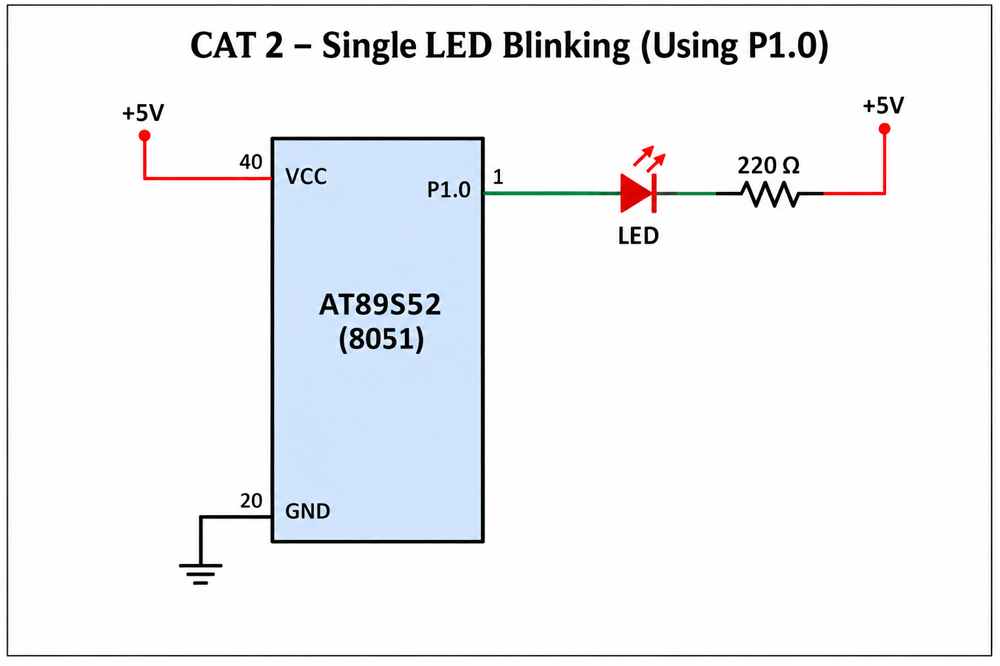

TASK 2A

# CAT2 – Hardware Board Bring-Up and Bare-Metal LED Blink

## Aim
To perform hardware board bring-up and implement a bare-metal LED blink program using direct register access and a custom software delay function.

## 1. Hardware Board Bring-Up

### Hardware Used
- STM32F103C8T6 Blue Pill Development Board
- USB-to-Serial / ST-Link programmer (as applicable)
- USB power supply
- Digital Multimeter
- Host Computer

### Hardware Bring-Up Procedure
1. Identify the STM32 microcontroller, CPU core, operating voltage, debugger interface, and onboard LED.
2. Verify the board's power rails using a digital multimeter.
3. Identify the LED GPIO port and pin from the board schematic.
4. Connect the board to the host computer.
5. Establish communication between the host computer and target MCU.
6. Verify that the board can be programmed and debugged successfully.

### Hardware Bring-Up Sheet

| Parameter | Student Entry |
|---|---|
| MCU | STM32F103C8T6 |
| CPU Core | ARM Cortex-M3 |
| Operating Voltage | 3.3 V |
| Debug Interface | SWD |
| LED GPIO Port | GPIOC |
| LED GPIO Pin | PC13 |
| LED Active State | LOW |
| LED Frequency | Approximately 1 Hz |

## 2. Bare-Metal LED Blink

### Aim
To configure the LED GPIO as an output using direct register access and blink the LED at approximately 1 Hz using a software delay loop.

### GPIO Configuration
- Enable the GPIOC peripheral clock.
- Configure PC13 as a general-purpose push-pull output.
- Toggle PC13 using GPIO registers.
- Implement a software delay using a loop.
- Repeat the process continuously.

### Algorithm
1. Start.
2. Enable GPIOC clock.
3. Configure PC13 as output.
4. Set PC13 LOW to turn ON the LED.
5. Execute the custom delay function.
6. Set PC13 HIGH to turn OFF the LED.
7. Execute the custom delay function.
8. Repeat steps 4–7 continuously.

### Expected Output
The onboard LED blinks continuously at approximately 1 Hz.

## 3. Custom Delay Function

### Aim
To develop a customized library function for delay functionality.

### Procedure
1. Create a separate delay function.
2. Implement a software loop to generate a delay.
3. Call the delay function between LED ON and LED OFF operations.
4. Adjust the loop count to obtain the required blinking frequency.

### Result
Hardware board bring-up was performed, and a bare-metal LED blink program was implemented using direct register access and a custom software delay function.

