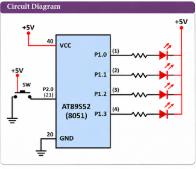

# CAT3 – Register-Level GPIO Controller

## Aim
To design and implement a register-level GPIO controller for a microcontroller development board using bare-metal Embedded C and direct memory-mapped register access.

## Problem Statement
Develop the first user-interface subsystem for an IoT sensor node consisting of four LEDs connected to four GPIO pins and one push-button connected to a GPIO input.

The microcontroller must respond to button presses by changing the LED operating mode.

## Required Hardware
- Microcontroller development board
- Four LEDs
- One push-button
- Current-limiting resistors
- Breadboard
- Jumper wires

## Required Behaviour

### Mode 1 – Running LED
Initially, all LEDs are OFF.

When the push-button is pressed, the system enters Mode 1.

LED1 → LED2 → LED3 → LED4 → LED1 → ...

### Mode 2 – Binary Counter
The four LEDs display a binary count:

```text
0000
0001
0010
0011
0100
...
1111
0000
```

### Mode 3 – Alternating Pattern
On the third button press:

```text
1010
0101
1010
0101
...
```

### Mode 4 – All LED Flash
On the fourth button press:

```text
1111
0000
1111
0000
...
```

## Quick Hacks
1. Check with switch event: Button Pressed?
2. Four modes as four states.

## Implementation Requirements
- Configure four GPIO pins as digital outputs.
- Configure one GPIO pin as digital input.
- Use bare-metal Embedded C.
- Access GPIO registers directly using memory-mapped register access.
- Implement button debouncing.
- Ensure one physical button press produces exactly one state transition.

## Circuit Diagram


## Result
The register-level GPIO controller was designed and implemented with four LED operating modes controlled by a push-button.


