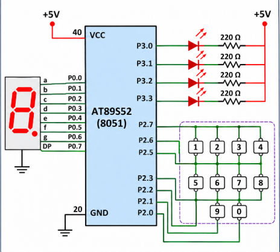

# CAT4 – Keypad, Seven-Segment Display & LED Control

## Aim
To design a simple embedded user interface in which the keypad acts as an input device, the seven-segment display provides visual feedback, and the LEDs indicate different operating modes.

## Problem Statement
Design an embedded user interface where:
- The keypad acts as an input device.
- The seven-segment display provides visual feedback.
- LEDs indicate different operating modes.

Whenever a valid key is pressed:
1. Display the key value on the seven-segment display.
2. Execute the corresponding LED function.

## Functional Requirements

| Key Press | Seven-Segment Display | LED Operation |
|---|---|---|
| 1 | 1 | LED1 ON |
| 2 | 2 | LED2 ON |
| 3 | 3 | LED3 ON |
| 4 | 4 | LED4 ON |
| 5 | 5 | Running LED Pattern |
| 6 | 6 | Alternate LEDs (1010 ↔ 0101) |
| 7 | 7 | Binary Counter (0–15) |
| 8 | 8 | All LEDs Blink |
| 9 | 9 | All LEDs OFF |
| 0 | 0 | Reset System |

## Program Structure

The program shall consist of separate functions:

```c
void keypad_scan(void);
void display_digit(unsigned char value);
void led_control(unsigned char key);
void running_led(void);
void binary_counter(void);
void alternate_led(void);
void blink_all(void);
```

## Circuit Diagram



## Result
The embedded user interface is implemented using a keypad, seven-segment display, and LEDs to perform the specified LED operations based on the pressed key.

