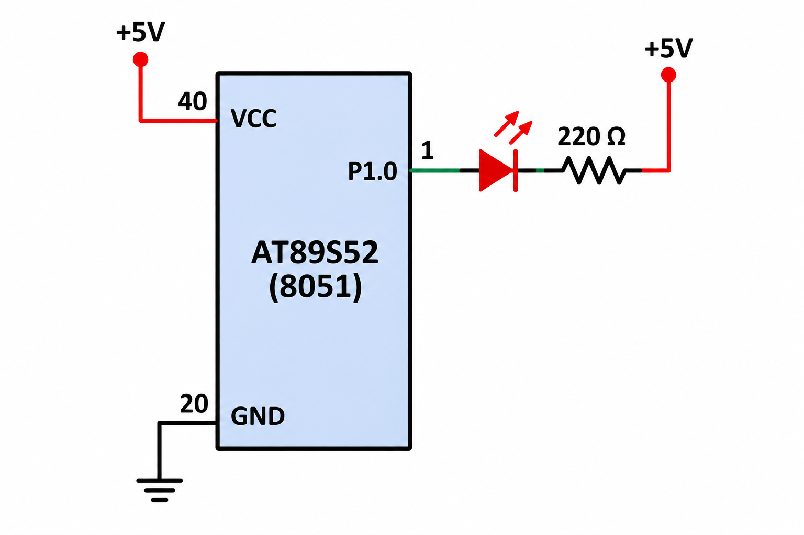

# CAT5 – Timer Interrupts and Software PWM

## Aim
To implement timer-based applications on the 8051 microcontroller using interrupts and non-blocking software techniques.

## Task List
1. LED fading using software PWM.
2. Variable-frequency square-wave generation.
3. Stepper-motor speed and direction control (optional).

**Note:** The implementation must be non-blocking and must not use software delay loops for timing.

## Task 1 – LED Fading Using Software PWM

### Aim
To configure Timer 0 to generate a precise periodic interrupt and use the timer interrupt to create a software time base.

### Procedure
1. Configure Timer 0 in the 8051 microcontroller.
2. Generate a periodic timer interrupt.
3. Use the timer interrupt to create a software time base.
4. Toggle an LED every 1 second.
5. Verify the generated timing using an oscilloscope.

### Timer Calculation

For a classic 12-clock 8051:

\[
T_{machine}=\frac{12}{f_{crystal}}
\]

For an 11.0592 MHz crystal:

\[
T_{machine}\approx1.085\ \mu s
\]

For a 1 ms interrupt:

\[
N=\frac{1ms}{1.085\mu s}\approx922
\]

Timer preload:

\[
65536-922=64614=FC66_H
\]

### Timer Configuration

```c
TH0 = 0xFC;
TL0 = 0x66;
```

## Circuit Diagram



## Result
Timer 0 is configured to generate periodic interrupts, and a software time base is used to control LED timing without blocking software delay loops.
