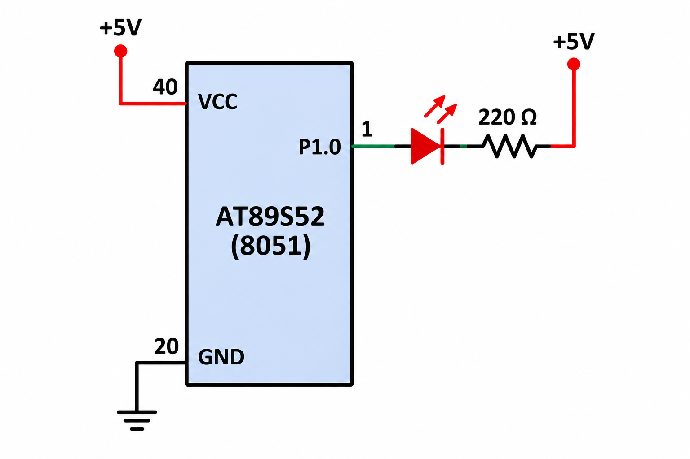

# CAT5B – Software PWM and Waveform Generation

## Aim
To generate software PWM using timer interrupts and gradually vary the duty cycle from 0% to 100% and back to 0%, producing a visible LED fading effect.

## 1. LED Fading Using Software PWM

### Working Principle
Using the timer interrupt developed in CAT5A, generate a software PWM signal and gradually vary the duty cycle.

```text
0% → 10% → 20% → 30% → ... → 100%
   → 90% → 80% → ... → 10% → 0%
```

### Suggested PWM Frequency
- Approximately 500 Hz – 1 kHz.
- LED should appear continuously illuminated rather than visibly flickering.

### Duty Cycle and Brightness

| Duty Cycle | LED Brightness |
|---|---|
| 0% | OFF |
| 25% | Dim |
| 50% | Medium |
| 75% | Bright |
| 100% | Fully ON |

## 2. Variable-Frequency Square-Wave Generation

Configure a GPIO pin as a signal output and use the timer interrupt to generate square-wave signals of different frequencies.

| Mode | Frequency |
|---|---|
| Mode 1 | 100 Hz |
| Mode 2 | 500 Hz |
| Mode 3 | 1 kHz |
| Mode 4 | 2 kHz |
| Mode 5 | 5 kHz |

Measure output frequency and duty cycle using an oscilloscope.

## 3. Different Signal Types

### Square Wave
```text
101010101010
```

### Variable Duty-Cycle Wave
```text
1111000011110000
```

### Pulse Train
```text
100000001000000010000000
```

### Burst Signal
```text
10101010 00000000 10101010
```

## Circuit Diagram


## Result
Software PWM and variable-frequency waveform generation are implemented using timer interrupts and non-blocking techniques.
