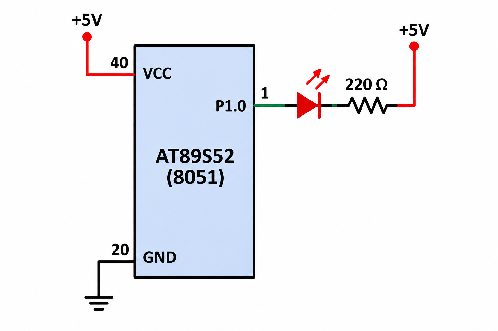

# CAT5C – Stepper Motor Control

## Aim
To control stepper motor speed and direction using timer interrupts.

## Working Principle
1. Timer interrupt occurs.
2. Generate the next step.
3. Update the motor coil sequence.
4. Repeat continuously to rotate the motor.

## Step Sequence

```text
1000
0100
0010
0001
```

## Speed Control

| Speed | Timer Interval |
|---|---|
| Slow | 100 ms/step |
| Medium | 50 ms/step |
| Fast | 10 ms/step |

The timer interval determines motor speed.

## Circuit Diagram


## Result
Stepper motor speed and direction are controlled using timer interrupts and a step sequence.
