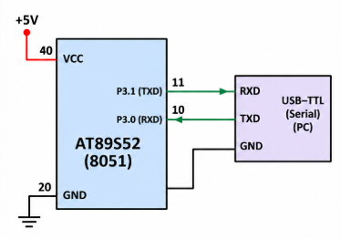

# CAT6A – UART Initialization and Character Transmission

## Aim
To develop a basic interrupt-driven UART driver for the 8051 and use a PC terminal such as PuTTY to transmit and receive characters.

## Problem Statement
Develop an interrupt-driven UART driver for the 8051 that communicates with a PC terminal through a USB-to-TTL serial interface.

Configure the UART for 9600-8-N-1 communication and demonstrate character transmission and reception using PuTTY.

## Task A – UART Initialization and Character Transmission

### UART Configuration
Configure the 8051 UART for:

- 8-bit UART mode
- Asynchronous operation
- 9600 baud
- 1 stop bit
- No parity

### Hardware Connection

```text id="vkwf7d"
8051 Development Board
          |
         TX
          |
    USB-to-TTL Converter
          |
          PC
          |
        PuTTY
```

### Procedure
1. Configure the 8051 UART.
2. Establish serial communication through a USB-to-TTL converter.
3. Configure PuTTY with the required serial settings.
4. Transmit the message continuously from the 8051.

### Expected Output

```text id="kyun44"
Hello from 8051
```

## Circuit Diagram


## Result
UART initialization and character transmission are implemented successfully, and the message is displayed in PuTTY.
