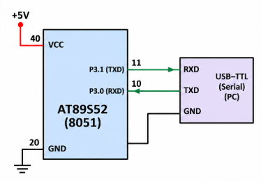

# CAT6B – UART Echo

## Aim
To implement an interactive UART echo experiment using the 8051 microcontroller.

## Problem Statement
Develop an interrupt-driven UART driver for the 8051 that receives characters from a PC terminal and returns the same characters to the terminal.

## Task B – UART Echo

### Requirement
Whatever character is typed in PuTTY must be returned by the 8051.

### Example

If the student types:

```text id="m4u8ce"
ABC123
```

The terminal should display:

```text id="8zv50p"
ABC123
```

## Implementation Requirements
- Receive characters from PuTTY.
- Process received characters using UART.
- Transmit the same characters back to the PC terminal.
- Implement UART transmit and receive functions.
- Implement an interrupt-driven RX ring buffer.

## Circuit Diagram


## Result
UART echo is implemented successfully, and characters entered in PuTTY are returned by the 8051.
