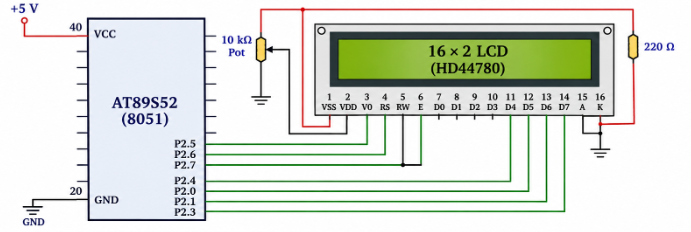

# CAT7A – LCD Initialization and Character/String Display

## Aim
To develop a 4-bit GPIO-based LCD driver by deriving the required command sequence from the HD44780-compatible LCD datasheet.

## Task 7A – LCD Initialization and Character/String Display

### Requirements
- Configure the LCD in 4-bit, 2-line mode.
- Implement `lcd_init()`, `lcd_cmd()` and `lcd_data()`.
- Display individual characters and strings.
- Display text on both rows.

## Circuit Diagram

## Result
A 4-bit GPIO-based LCD driver is developed to initialize the LCD and display characters and strings on both rows.
