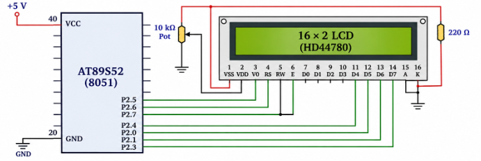

# CAT7B – Cursor Positioning and Dynamic Value Update

## Aim
To develop LCD cursor-positioning and data-update functions.

## Task 7B – Cursor Positioning and Dynamic Value Update

### Functions to Implement

```c
lcd_goto(row, column);
lcd_puts(string);
lcd_print_number(value);
```

### Requirements
- Position the LCD cursor at a specified row and column.
- Display strings at the selected cursor position.
- Display numerical values on the LCD.
- Update displayed values dynamically.

## Circuit Diagram


## Result
LCD cursor positioning and dynamic value-update functions are implemented.
