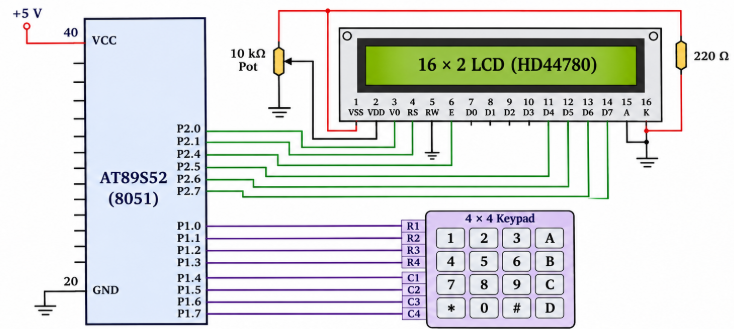

# CAT7C – 4x4 Keypad-Based Character Movement

## Aim
To develop an interactive LCD application in which a character is moved across the 16x2 LCD display using a 4x4 keypad.

## Task 7C – Character Movement

### Directional Controls

| Key | Action |
|---|---|
| 2 | ↑ Move Up |
| 8 | ↓ Move Down |
| 4 | ← Move Left |
| 6 | → Move Right |

### Requirements
- Interface the 4x4 keypad with the microcontroller.
- Display a character on the LCD.
- Use keypad inputs to control character movement.
- Move the character across the 16x2 LCD display.

## Circuit Diagram

## Result
An interactive LCD application is developed in which a character moves across the display using keypad directional controls.
