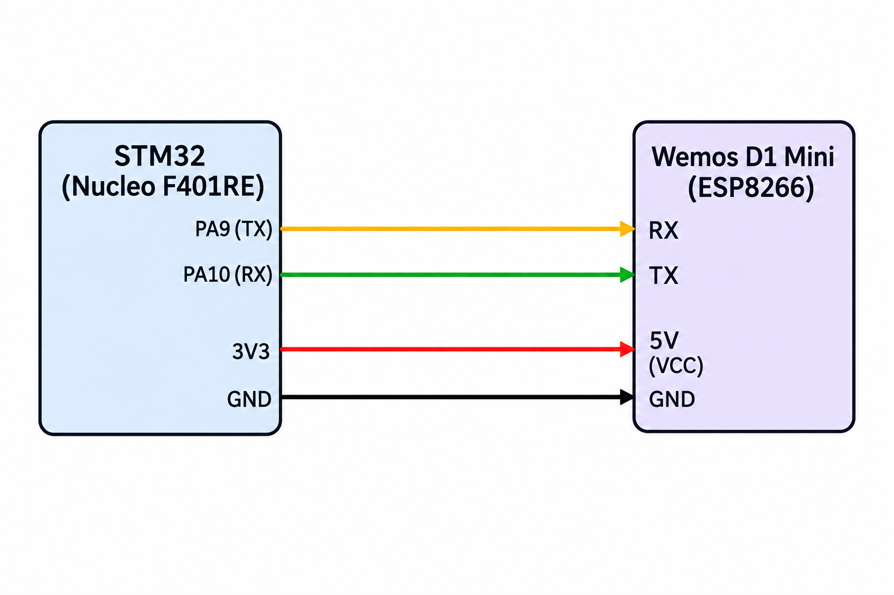

# CAT10A – STM32 and Wemos UART Communication

## Aim
To interface an STM32 board with a Wemos Mini/ESP8266 through UART, configure the Wi-Fi modem using AT commands, acquire sensor data through STM32, and transmit the sensor data over a Wi-Fi network.

## Task 10A – Establish STM32 ↔ Wemos UART Communication

### Problem Statement
Interface an STM32 board with a Wemos Mini/ESP8266 through UART and verify communication between both boards before attempting Wi-Fi configuration.

### Hardware Connections

| Wemos D1 Mini Pin | STM32 Pin | Description |
|---|---|---|
| TX | RX (PA3 / USART2_RX) | Data from Wemos to STM32 |
| RX | TX (PA2 / USART2_TX) | Data from STM32 to Wemos |
| GND | GND | Common ground reference |
| 5V / 3.3V | 5V / 3.3V | Appropriate power source |

### Procedure
1. Establish UART communication between STM32 and Wemos.
2. Configure UART on STM32.
3. Transmit the AT command followed by CR/LF.
4. Receive and display the Wemos response on the PC terminal.
5. Verify successful communication.

### Expected Output

```text
STM32 → Wemos
AT\r\n

Wemos → STM32
OK
```

## Circuit Diagram



## Result
UART communication between STM32 and Wemos is established successfully, and the AT command response is displayed on the PC terminal.
