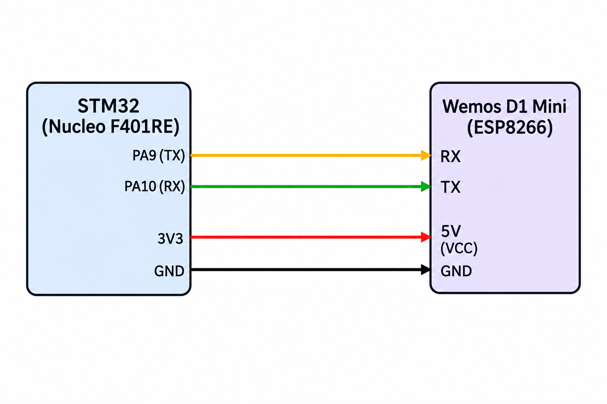

# CAT10B – ESP8266 AT Command Interface

## Aim
To explore the ESP8266 AT command interface and investigate commands used for Wi-Fi configuration.

## Task 10B – Explore the ESP8266 AT Command Interface

### Problem Statement
Investigate ESP8266 AT commands and determine the appropriate commands for modem configuration and network operations.

### Command Investigation Table

| Requirement | Command to Investigate |
|---|---|
| Check modem response | AT |
| Check firmware/version | AT+GMR |
| Set Wi-Fi station mode | AT+CWMODE=1 |
| Scan available networks | AT+CWLAP |

### Procedure
1. Establish UART communication between STM32 and Wemos.
2. Transmit the required AT commands.
3. Receive and examine the modem responses.
4. Identify the commands required for Wi-Fi configuration.
5. Record the command and its corresponding response.

## Circuit Diagram

## Result
ESP8266 AT commands are investigated, and the commands required for modem configuration and Wi-Fi network operations are identified.
