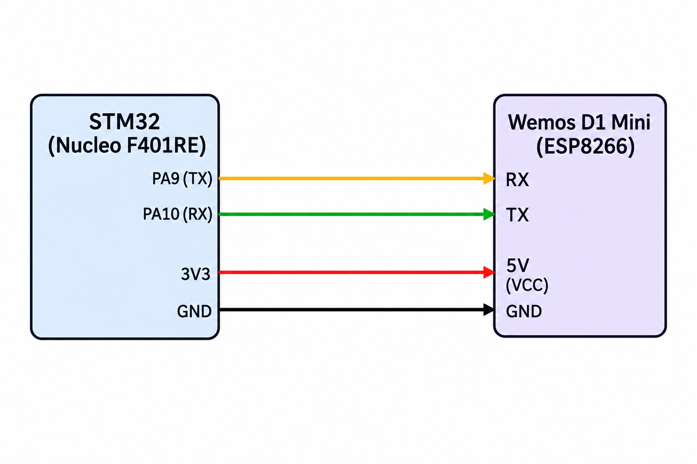

# CAT10C – HTTP Browser Communication Using ESP8266

## Aim
To configure the ESP8266 as an HTTP server, obtain its IP address, and access the STM32-based application through a web browser.

## Problem Statement
Configure the ESP8266 Wi-Fi modem using AT commands, establish a Wi-Fi connection, obtain the IP address, and enable HTTP communication with a PC browser.

## Procedure

1. Establish UART communication between STM32 and Wemos.
2. Configure the ESP8266 Wi-Fi station mode.
3. Connect the ESP8266 to the Wi-Fi network.
4. Obtain the ESP8266 IP address.
5. Configure the ESP8266 as a TCP server on port 80.
6. Configure the HTTP response in STM32 firmware.
7. Open the ESP8266 IP address in a web browser.
8. Verify that the browser receives the HTTP response.

## Communication Flow

```text
PC Browser
    |
    | HTTP Request
    v
ESP8266 / Wemos
    |
    | UART
    v
STM32
    |
    | HTTP Response
    v
ESP8266
    |
    v
PC Browser
```

## AT Commands Used

```text
AT
AT+CWMODE=1
AT+CWJAP="SSID","PASSWORD"
AT+CIFSR
AT+CIPMUX=1
AT+CIPSERVER=1,80
```

## Expected Output
- ESP8266 successfully connects to the Wi-Fi network.
- ESP8266 IP address is obtained.
- HTTP server is configured on port 80.
- Browser receives the HTTP response from STM32 through ESP8266.

## Circuit Diagram



## Result
The ESP8266 is configured as an HTTP server, and browser communication is established using the obtained IP address.
