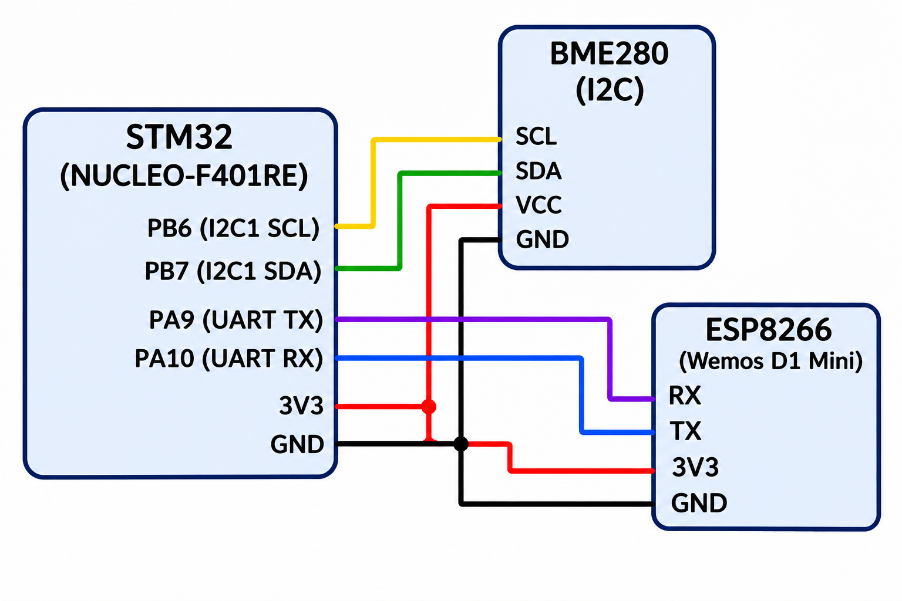

# CAT11A – On-board LED Bring-Up

## Aim
To develop and program an STM32 application to verify the NUCLEO-F401RE hardware and GPIO output configuration by blinking the on-board LED at a fixed interval.

## Prerequisites
1. Observe the on-board oscillator frequency.
2. Check the STM32 controller specifications, including clock frequency, GPIO groups, UARTs, I2Cs, and SPIs.
3. Decide on the clock configuration settings in CubeMX.
4. Refer to the Nucleo Board STM32F401RE/RB pinout.
## Circuit Diagram

## Task 1 – On-board LED Bring-Up

### Requirements
- Verify the NUCLEO-F401RE hardware.
- Configure GPIO output.
- Blink the on-board LED at a fixed interval.
- Verify the GPIO output configuration.

## Result
The on-board LED is successfully configured and blinked at a fixed interval.
