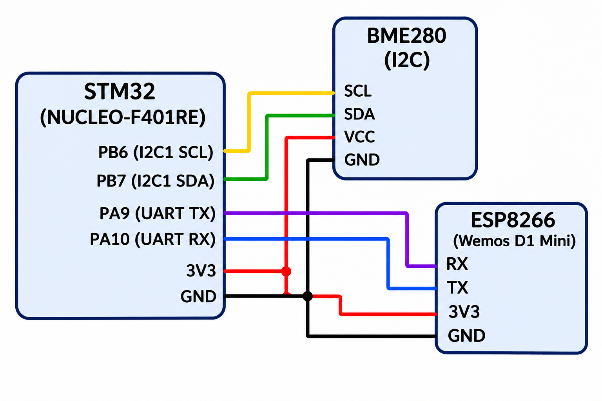

TASK 11B
# CAT11B – On-board Switch Control with State Remembrance

## Aim
To modify the application so that the on-board push button controls the LED and the LED remembers its previous state.

## Task 2 – On-board Switch Control with State Remembrance

## Circuit Diagram

### Requirements
- Configure the on-board push button as GPIO input.
- Detect a valid button press.
- Toggle the LED state whenever a valid button press is detected.
- Preserve the previous LED state after the button is released.

## Working Principle
1. Initialize the LED and push-button GPIO pins.
2. Read the push-button input.
3. Detect a valid button press.
4. Toggle the LED state.
5. Maintain the LED state after button release.

## Result
The on-board push button controls the LED, and the LED retains its state after the button is released.
