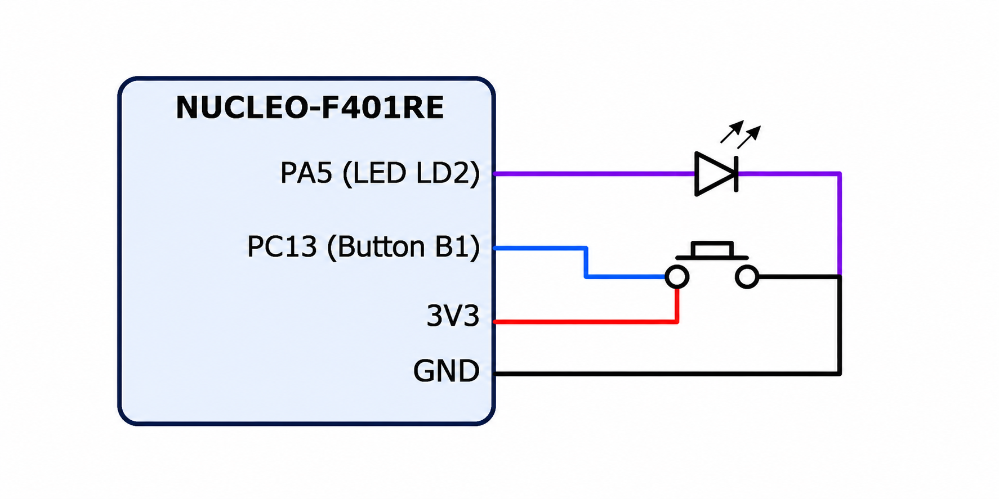

 # CAT12 – BME Sensor Environmental Data Acquisition

## Aim
To interface a BME sensor with a microcontroller and acquire environmental data such as temperature, humidity, and pressure.

## Objective
- Interface the BME sensor with the development board.
- Configure the required communication interface.
- Read environmental parameters from the sensor.
- Display the sensor readings through the serial monitor.

## Working Principle
1. Initialize the BME sensor.
2. Establish communication between the sensor and microcontroller.
3. Read temperature, humidity, and pressure values.
4. Process the sensor data.
5. Display the readings on the serial monitor.

## System Architecture

```text
Environment
    |
    v
BME Sensor
    |
    v
Microcontroller
    |
    v
Environmental Readings
```

## Circuit Diagram



## Result
Environmental parameters are successfully acquired from the BME sensor and displayed through the serial monitor.
