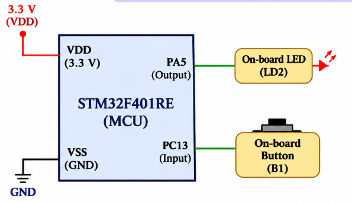

# CAT8A – GPIO Input/Output

## Aim
To interface a push-button and LED with the STM32 microcontroller and configure GPIO pins so that the LED follows the switch state.

## Task 8A – GPIO Input/Output

### Requirements
- Interface a push-button and LED with STM32.
- Configure the corresponding GPIO pins.
- Develop firmware so that the LED follows the switch state.
## Circuit Diagram

## Result
GPIO input/output is implemented, and the LED follows the push-button state.
