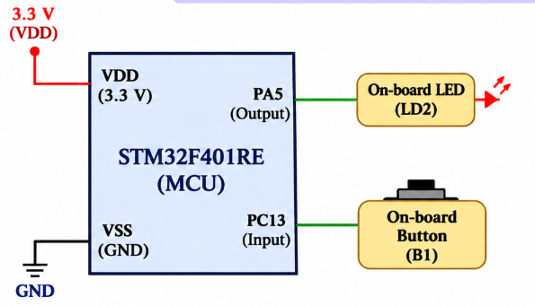

# CAT8B – Event-Based Control

## Aim
To modify the firmware so that each valid switch press toggles the LED state.

## Task 8B – Event-Based Control

### Requirements
- Detect each valid switch press.
- Toggle the LED state on every valid press.
- Investigate switch bounce.
- Implement a simple software solution to ensure one press produces one toggle.

### Working Principle
1. Initialize GPIO pins for the push-button and LED.
2. Read the switch input continuously.
3. Detect a valid button press.
4. Apply software debouncing to eliminate switch bounce.
5. Toggle the LED state exactly once for each valid press.
6. Repeat the process.

### Circuit Diagram

### Result
Event-based LED control is implemented with switch debouncing so that one valid press produces exactly one LED toggle.
