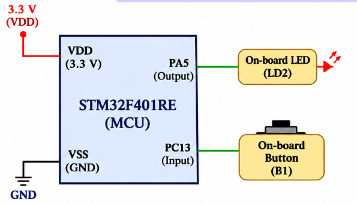

# CAT8C – Short Press vs Long Press

## Aim
To modify the application to classify a button press according to how long the button remains pressed.

## Task 8C – Short Press vs Long Press

### Press Classification
- Short press: less than 1 second.
- Long press: greater than or equal to 1 second.

### Functional Requirements

| User Action | System Response |
|---|---|
| Short press | Toggle LED |
| Long press | LED enters continuous blinking mode |
| Next short press | Stop blinking |
| Long press again | Return to blinking mode |

### Working Principle
1. Initialize GPIO pins for the push-button and LED.
2. Detect button press and record the press start time.
3. Measure how long the button remains pressed.
4. Classify the press as short or long.
5. Execute the corresponding LED operation.
6. Repeat the process.

### Circuit Diagram

### Result
Short and long button presses are classified, and the LED responds according to the specified behavior.
