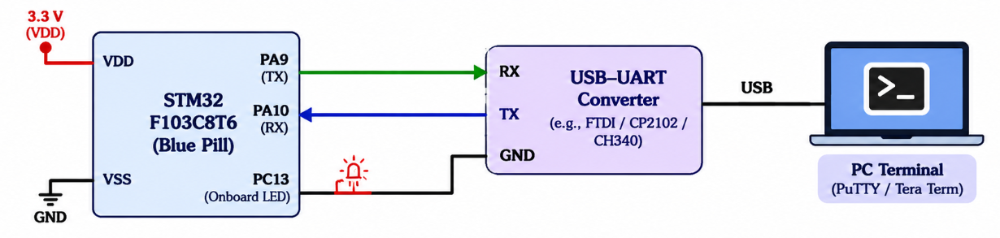

# CAT9A – Basic UART Communication

## Aim
To configure UART using STM32CubeMX and HAL, establish communication between the STM32 and a PC terminal, and implement character and string transmission/reception.

## Task 9A – Basic UART Communication

### 1. Transmit a Character
- Configure the STM32 UART for a standard serial configuration.
- Transmit a character repeatedly to a PC terminal.

### 2. Receive and Echo
- Modify the code so that every character received from the PC is transmitted back to the PC.

## Circuit Diagram

# CAT9A – Basic UART Communication

## Aim
To configure UART using STM32CubeMX and HAL, establish communication between the STM32 and a PC terminal, and implement character and string transmission/reception.

## Task 9A – Basic UART Communication

### 1. Transmit a Character
- Configure the STM32 UART for a standard serial configuration.
- Transmit a character repeatedly to a PC terminal.

### 2. Receive and Echo
- Modify the code so that every character received from the PC is transmitted back to the PC.

## Circuit Diagram

## Result
UART communication is established between the STM32 and PC terminal, supporting character transmission and reception with echo functionality.

## Result
UART communication is established between the STM32 and PC terminal, supporting character transmission and reception with echo functionality.
