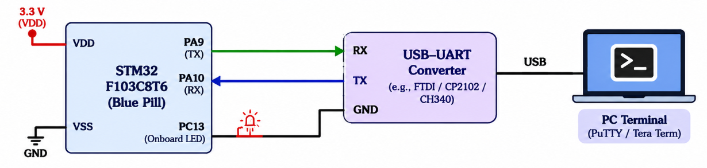

# CAT9B – String-Based Application Logic

## Aim
To develop a UART-based command interface for an STM32 device that accepts commands from a terminal and controls the onboard LED.

## Task 9B – UART Command Interface

The system shall accept commands from a terminal and control the onboard LED.

### Commands and Responses

| Command | LED Operation | Response |
|---|---|---|
| LED ON | LED turned ON | LED turned ON |
| LED OFF | LED turned OFF | LED turned OFF |
| LED TOGGLE | LED toggled | LED toggled |

## Working Principle
1. Configure UART using STM32CubeMX and HAL.
2. Receive commands from the PC terminal.
3. Process the received command string.
4. Execute the corresponding LED operation.
5. Send the response back to the terminal.

## Circuit Diagram

## Result
A UART-based command interface is implemented to control the onboard LED through terminal commands.
